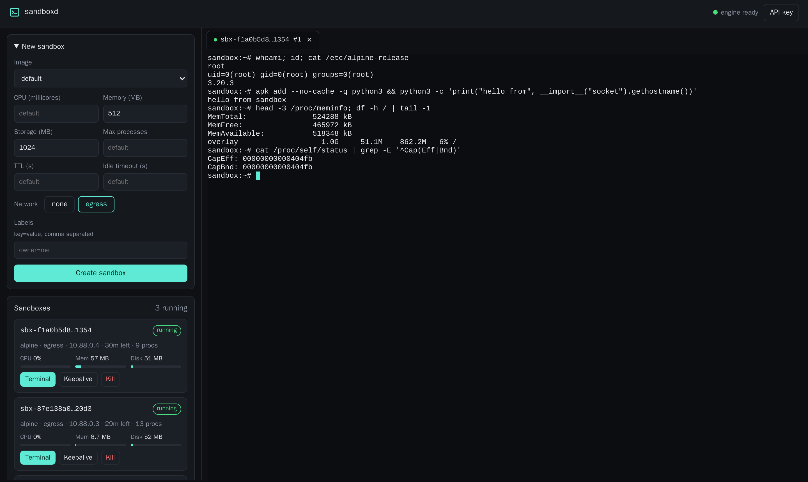
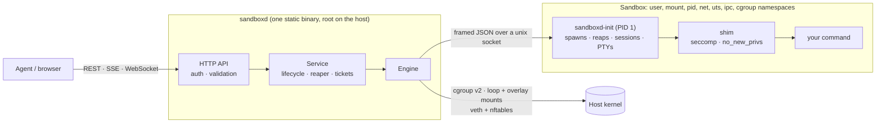
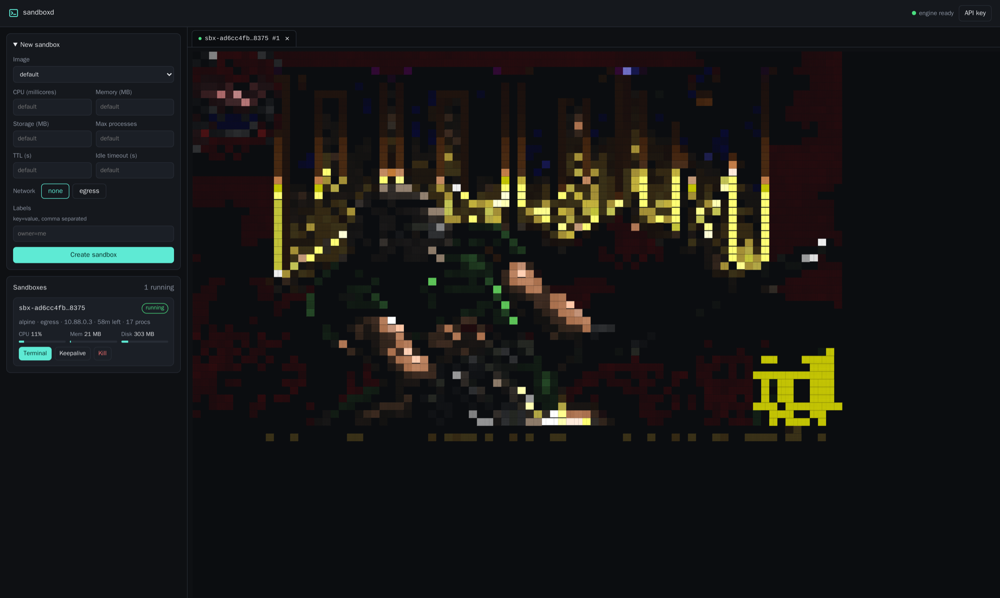

<div align="center">


# sandboxd

**Disposable, resource-limited Linux sandboxes for AI agents, in a single binary.**

[](https://github.com/bpradana/sandboxd/actions/workflows/ci.yml)
[](https://pkg.go.dev/github.com/bpradana/sandboxd)
[](https://goreportcard.com/report/github.com/bpradana/sandboxd)
[](LICENSE)


[Quick start](#quick-start) ·
[Deploy](#production-deployment) ·
[API](#api) ·
[Security model](#security-model) ·
[Configuration](#configuration) ·
[Contributing](CONTRIBUTING.md)

</div>

---

sandboxd gives agents a place to run untrusted code. An agent creates a sandbox, runs
commands in it (one-shot, streamed, or in a persistent shell), installs packages, moves
files in and out, and destroys it. Every sandbox gets its own CPU, memory, storage,
process, and network limits, and an expiry.

There is no Docker, containerd, runc, or Firecracker underneath. sandboxd builds each
sandbox directly from Linux kernel primitives (namespaces, cgroups v2, overlayfs,
seccomp, capabilities, and nftables) and ships as one static Go executable with a REST
API and a built-in web console.

```console
$ curl -s -XPOST localhost:8080/api/v1/sandboxes -d '{"network": "egress"}' | jq -r .data.id
sbx-1f0c7a3e9b2d4c6e8a0b1c2d
$ curl -s -XPOST localhost:8080/api/v1/sandboxes/sbx-1f0c…/exec \
    -d '{"command": "apk add -q python3 && python3 -c \"print(6*7)\""}' | jq -r .data.stdout
42
```

<div align="center">

<br><sub>The web console: create, watch, and kill sandboxes, and open real terminals into them.</sub>
</div>

## Contents

- [Features](#features)
- [Quick start](#quick-start)
- [How it works](#how-it-works)
- [Security model](#security-model)
- [Host requirements](#host-requirements)
- [Production deployment](#production-deployment)
- [Base images](#base-images)
- [Web console](#web-console)
- [API](#api)
- [Behaviour reference](#behaviour-reference)
- [Configuration](#configuration)
- [Operations](#operations)
- [Troubleshooting](#troubleshooting)
- [Development](#development)
- [Known limitations](#known-limitations)
- [Yes, it runs DOOM](#yes-it-runs-doom)
- [License](#license)

## Features

| | |
|---|---|
| 🧱 **Kernel-level isolation** | Its own user, mount, PID, network, UTS, IPC, and cgroup namespaces per sandbox; seccomp, `no_new_privs`, and a reduced capability set for every command. |
| 🔑 **Root inside, nobody outside** | Commands run as root inside the sandbox, so `apt install` and `apk add` work. On the host that root is an unprivileged uid with nine namespace-scoped capabilities. An unprivileged `sandbox` user is available too. |
| 📏 **Enforced limits** | CPU, memory, storage, processes, command timeouts, output size, TTL, and idle timeout, with server-side defaults and maximums. |
| 💾 **Disk-backed storage** | Each sandbox gets its own ext4 or btrfs filesystem in a sparse image file, capped at its storage size and allocated as data is written. tmpfs is available as an alternative. |
| ⚡ **Three ways to run code** | One-shot `exec` (buffered or streamed as Server-Sent Events), persistent shell sessions that keep state between calls, and interactive PTY terminals over WebSocket that survive disconnects. |
| 📁 **Safe file API** | Upload, download, list, stat, mkdir, and remove. Every path resolves inside the sandbox, including through symlinks. |
| ☁️ **Cloud filesystem snapshots** | Save-and-stop a sandbox into S3-compatible storage, then restore its files, installed packages, and configuration on the same host or another host of the same architecture. |
| 🌐 **Controlled networking** | `none` (loopback only) or `egress` (internet through NAT, with private, link-local, cloud-metadata, and host addresses blocked). |
| 🧹 **Automatic cleanup** | Sandboxes are reaped at their TTL or when idle. Shutdown destroys every sandbox, and startup removes anything a crash left behind. |
| 🖥️ **Web console** | Create, monitor, extend, and kill sandboxes from the browser, with terminal tabs that persist across page reloads. |
| 📊 **Operable** | Prometheus metrics, OpenTelemetry tracing, structured logs, health probes, and an OpenAPI specification. |

## Quick start

sandboxd runs on Linux. Development happens entirely inside a privileged Docker
container, so the same steps work on macOS (Docker Desktop or OrbStack) and Linux. You
need [mise](https://mise.jdx.dev) and Docker.

```sh
git clone https://github.com/bpradana/sandboxd.git && cd sandboxd
mise run tools          # host tools and the dev image
mise run docker image   # download Alpine and import it as image "alpine"
mise run dev up         # API on :8080, console at http://localhost:8080/ui/
```

Open **http://localhost:8080/ui/** and click **Create sandbox**, or use the API:

```sh
API=http://localhost:8080/api/v1
ID=$(curl -s -XPOST $API/sandboxes -d '{"network": "egress"}' | jq -r .data.id)

curl -s -XPOST $API/sandboxes/$ID/exec -d '{"command": "id; uname -a"}' | jq .data
curl -s -XPOST $API/sandboxes/$ID/exec -d '{"command": "apk add -q git && git --version"}' | jq -r .data.stdout
curl -s -XDELETE $API/sandboxes/$ID
```

The dev server runs without API keys. `mise run dev logs` follows the logs, and
`mise run dev down` stops it.

## How it works



The single binary plays every role: daemon, management CLI, the PID 1 of each sandbox,
and the per-command shim. Creating a sandbox goes through these steps:

1. The daemon creates the sandbox's cgroup, makes and loop-mounts its storage image, and
   mounts an overlay of that storage over the read-only base image.
2. It re-executes a sealed in-memory copy of itself as `sandboxd-init`, in new
   namespaces and directly inside the cgroup (`clone3(CLONE_INTO_CGROUP)`).
3. It wires the network from the host side, hands init its configuration, and waits.
4. Init mounts `/proc`, `/sys`, the sandbox's own cgroup, and a minimal `/dev`, masks
   kernel interfaces, pivots into the overlay, drops capabilities, and serves the agent
   socket.
5. Each command starts through the shim as the requested user, in its own process group.

<details>
<summary><b>Source layout</b></summary>

```
cmd/api, cmd/cli               entrypoints (sandboxdctl is the shipped binary)
internal/fx                    Uber Fx graph: config → bootstrap → metrics → repository → engine → service → handler → httpapi → route
internal/config                environment configuration and validation
internal/transport/httpapi     Fiber server, middleware, health, metrics, docs, web console
internal/handler/http/sandbox  one file per endpoint, with swag annotations
internal/service/sandbox       lifecycle, exec, sessions, terminals, files, TTL/idle reaper
internal/repository/sandbox    in-memory registry (intentionally not persisted)
internal/engine                kernel engine (Linux) and an unsupported stub (other OSes)
  ├─ cgroup                    delegation, limits, stats, kill
  ├─ storage                   disk-image (loop) and tmpfs writable layers
  ├─ rootfs                    in-sandbox mounts, masking, pivot_root
  ├─ netns                     bridge, veth, IPAM, nftables
  ├─ seccomp                   syscall filter
  ├─ fsops                     openat2-confined file operations
  ├─ image                     base image store and safe import
  ├─ agent                     daemon ⇄ init framed protocol
  ├─ initproc                  PID 1: spawning, reaping, timeouts, sessions, PTYs, /proc/meminfo
  ├─ shim                      per command: OOM score, cwd, no_new_privs + seccomp, signals, execve
  └─ reexec                    argv[0] dispatch: one binary is daemon, init, and shim
web/dist                       web console (static, embedded; vendored xterm.js)
test                           end-to-end suite against the real kernel
```

</details>

## Security model

> [!WARNING]
> **sandboxd sandboxes are containers: they share the host kernel.** A kernel
> vulnerability can break isolation. sandboxd stacks several independent layers to make
> that hard, but it does **not** give the guarantees of a hardware-virtualized microVM.
> Run untrusted workloads on dedicated hosts or VMs, keep the kernel patched, and treat
> the host as part of the trust boundary.

| Layer | Mechanism |
|---|---|
| **Namespaces** | `CLONE_NEWUSER`, `NEWPID`, `NEWNS`, `NEWNET`, `NEWUTS`, `NEWIPC`, `NEWCGROUP` |
| **Identity** | Sandbox uid/gid 0–65535 map to host 100000–165535. Root inside (the default user) is host uid 100000; the `sandbox` user is uid 1000 inside. |
| **Capabilities** | Root keeps only `CHOWN`, `DAC_OVERRIDE`, `FOWNER`, `FSETID`, `KILL`, `SETUID`, `SETGID`, `NET_BIND_SERVICE`, and `SYS_CHROOT`, all scoped to the sandbox's user namespace. `SYS_ADMIN`, `NET_ADMIN`, `NET_RAW`, `SYS_PTRACE`, `MKNOD`, `SYS_RESOURCE`, and every other capability are dropped from every thread's bounding set. The `sandbox` user holds none. |
| **Syscalls** | `no_new_privs`, plus a seccomp deny-list: ptrace, mount, unshare and setns, bpf, keyctl, io_uring, perf, kexec, kernel modules, clock changes, and more. `user.max_user_namespaces=0` also blocks `clone3`. |
| **Kernel interfaces** | Sensitive `/proc` and `/sys` paths are masked or read-only, and IPv6 is disabled. `/proc/meminfo` and `/sys/fs/cgroup` show the sandbox's own values. |
| **Resources** | cgroup v2: `cpu.max`, `memory.max`, `memory.swap.max=0`, and `pids.max`. Teardown uses `cgroup.kill`. |
| **Filesystem** | An overlay on a read-only base image, over a writable layer that is its own filesystem of exactly `storage_mb`, mounted `nosuid,nodev`. `pivot_root` with the old root detached. |
| **Network** | A veth on an isolated bridge port. nftables NATs outbound traffic and drops traffic to RFC 1918, link-local (including cloud metadata `169.254.169.254`), CGNAT, loopback, multicast, the host itself, other sandboxes, and any `SANDBOX_NETWORK_EGRESS_DENY` ranges. |
| **Host file access** | Every file API path resolves with `openat2(RESOLVE_IN_ROOT \| RESOLVE_NO_MAGICLINKS \| RESOLVE_NO_XDEV)`. A symlink to `/etc/shadow` yields the sandbox's copy, never the host's. |
| **Binary integrity** | Sandboxes start from a sealed `memfd` copy of the executable, which blocks CVE-2019-5736-style overwrites. |
| **Daemon channel** | A unix socket outside the sandbox root. Every frame from inside is treated as untrusted. |

The end-to-end suite checks these properties against a real kernel. For example, it
asserts that root inside a sandbox cannot mount, unshare, change the hostname, create
network or device nodes, change sysctls, raise its cgroup limits, or read init's
`/proc` entries.

**API security**

- `/api/v1` requires `Authorization: Bearer <key>`. Keys come from `APP_API_KEYS`. They
  are compared as SHA-256 digests in constant time, and you can configure several keys
  for rotation. In production, startup fails without keys or with a key shorter than 16
  characters.
- Any valid key controls every sandbox. There are no per-tenant scopes; put a gateway in
  front of sandboxd if you need multi-tenancy.
- Terminal WebSockets use single-use tickets that are valid for 30 seconds and bound to
  one sandbox. Tickets are redacted from logs and traces.
- Browser WebSocket upgrades must come from the server's own origin or from
  `APP_CORS_ALLOWED_ORIGINS`, even without API keys. This blocks cross-site WebSocket
  hijacking.
- `/healthz`, `/readyz`, `/metrics`, `/openapi.json`, and `/ui/` are unauthenticated.
  Expose them only to networks you trust.

Found a vulnerability? Please report it privately; see [SECURITY.md](SECURITY.md).

## Host requirements

| Requirement | Why |
|---|---|
| Linux ≥ 5.14, amd64 or arm64 | `cgroup.kill`, `clone3(CLONE_INTO_CGROUP)`, `openat2`, overlayfs in user namespaces |
| cgroup v2 with `cpu`, `memory`, and `pids` delegated | Resource limits. Use `Delegate=yes` under systemd, or a private cgroup namespace in a container. |
| Root, or equivalent capabilities | Creates namespaces, mounts, cgroups, veths, and nftables rules |
| Loop devices and `mkfs.ext4` or `mkfs.btrfs` | Disk storage. Not needed with `SANDBOX_STORAGE_DRIVER=tmpfs`. |
| `nf_tables` | `egress` networking only. Set `SANDBOX_NETWORK_ENABLED=false` to run without it. |
| `SANDBOX_STATE_DIR` on ext4, xfs, or btrfs | overlayfs cannot stack on overlayfs |
| Static build (`CGO_ENABLED=0`) | The binary re-executes itself inside images that have no host libc |

At startup sandboxd checks these requirements. It also proves the storage limit holds,
by filling a small test filesystem and expecting `ENOSPC`. If a check fails, sandboxd
exits with an error that names the problem.

## Production deployment

### 1. Get the binary

Download `sandboxdctl` for your architecture from
[Releases](https://github.com/bpradana/sandboxd/releases), use the container image
`ghcr.io/bpradana/sandboxd`, or build it yourself:

```sh
mise run build --cli      # target/sandboxdctl, static
mise run build --docker   # the runtime image
```

### 2a. Run under systemd (recommended)

```sh
install -m 0755 sandboxdctl /usr/local/bin/sandboxdctl
install -d -m 0711 /var/lib/sandboxd
install -D -m 0600 .env.dist /etc/sandboxd/sandboxd.env      # then edit it (step 3)
install -m 0644 deploy/systemd/sandboxd.service /etc/systemd/system/
systemctl daemon-reload
sandboxdctl image import alpine ./alpine-minirootfs.tar.gz   # see Base images
systemctl enable --now sandboxd
```

The unit sets `Delegate=yes`, so sandboxd owns its cgroup subtree. It also sets
`KillMode=mixed` and `TimeoutStopSec=90`, so shutdown has time to destroy every
sandbox.

### 2b. Run as a container

```sh
docker run -d --name sandboxd \
  --privileged --cgroupns=private \
  --security-opt seccomp=unconfined --security-opt apparmor=unconfined \
  -v /var/lib/sandboxd:/var/lib/sandboxd \
  --env-file /etc/sandboxd/sandboxd.env \
  -p 127.0.0.1:8080:8080 \
  ghcr.io/bpradana/sandboxd:latest
```

The container is privileged because sandboxd does the work a container runtime normally
does. Mount `/var/lib/sandboxd` from a host ext4, xfs, or btrfs filesystem, never from
the container's own overlay. The image includes `mkfs.ext4` and `mkfs.btrfs`.

### 3. Configure

```sh
APP_ENV=production
APP_API_KEYS=<openssl rand -hex 32>[,<next key, for rotation>]
UI_ENABLED=false                  # enable only behind authentication you trust
SANDBOX_MAX_SANDBOXES=…           # see sizing below
SANDBOX_MAX_MEMORY_MB=…  SANDBOX_MAX_STORAGE_MB=…  SANDBOX_MAX_CPU_MILLIS=…
SANDBOX_NETWORK_EGRESS_DENY=<internal CIDRs outside RFC 1918, if any>
```

### 4. Put it behind a reverse proxy

Terminate TLS in front of sandboxd and keep port 8080 private. The proxy must:

- pass WebSocket upgrades for `/api/v1/sandboxes/*/terminal`
- preserve the `Host` header, because the terminal Origin check compares `Origin` with
  `Host` (or list the public origin in `APP_CORS_ALLOWED_ORIGINS`)
- disable buffering for `/exec/stream` and file downloads
- use timeouts longer than `SANDBOX_EXEC_MAX_TIMEOUT`
- allow bodies up to `SANDBOX_FILE_MAX_BYTES`

<details>
<summary><b>nginx example</b></summary>

```nginx
map $http_upgrade $connection_upgrade { default upgrade; '' close; }

server {
    # listen, server_name, and TLS settings omitted
    location / {
        proxy_pass http://127.0.0.1:8080;
        proxy_http_version 1.1;
        proxy_set_header Host $host;
        proxy_set_header Upgrade $http_upgrade;
        proxy_set_header Connection $connection_upgrade;
        proxy_buffering off;
        proxy_request_buffering off;
        proxy_read_timeout 35m;
        proxy_send_timeout 35m;
        client_max_body_size 100m;
    }
    location = /metrics { deny all; }
}
```

</details>

### 5. Size the host

```
RAM:  SANDBOX_MAX_SANDBOXES × SANDBOX_MAX_MEMORY_MB + ~100 MB
Disk: SANDBOX_MAX_SANDBOXES × SANDBOX_MAX_STORAGE_MB + images   (on SANDBOX_STATE_DIR)
```

Storage images are sparse: they occupy only what sandboxes write, and deleted files
return their space. With `SANDBOX_STORAGE_DRIVER=tmpfs`, storage is RAM, so add it to
the RAM line. CPU limits are hard quotas, so the total of `cpu_millis` may exceed the
host's cores.

### 6. Checklist

- [ ] `APP_ENV=production` and strong API keys
- [ ] TLS at the proxy, and port 8080 unreachable from outside
- [ ] `/metrics`, `/readyz`, and `/ui/` reachable only from trusted networks
- [ ] Limits sized to host RAM and disk
- [ ] `SANDBOX_NETWORK_EGRESS_DENY` covers internal ranges, or `SANDBOX_NETWORK_ENABLED=false`
- [ ] Host `FORWARD` policies allow the sandbox bridge (see [Troubleshooting](#troubleshooting))
- [ ] `SANDBOX_DEFAULT_USER` chosen: `root` lets agents install packages; `sandbox` is stricter
- [ ] Kernel patched, and the host dedicated to sandboxd
- [ ] Alerts on `/readyz`, failed creates, and host memory and disk
- [ ] Clients expect sandboxes to be lost when the daemon restarts

## Base images

An image is a root filesystem that each sandbox mounts read-only under its own writable
layer. Import any Linux root filesystem tarball:

```sh
sandboxdctl image import <name> <rootfs.tar[.gz] | ->
sandboxdctl image list
sandboxdctl image remove <name>       # only when no sandbox uses it
```

**Any distribution works**, because sandboxd's binary is static and needs nothing from
the image except `/bin/sh` (terminals prefer `/bin/bash`). Export any container image to
get one:

```sh
cid=$(docker create --platform linux/amd64 python:3.12-slim)   # match the host's arch
docker export "$cid" -o python.tar && docker rm "$cid"
sandboxdctl image import python python.tar
```

Agents can install packages at runtime as root. For speed and reproducibility, bake
common tools into the image instead:

```sh
docker build -t agent-env - <<'EOF'
FROM python:3.12-slim
RUN apt-get update && apt-get install -y --no-install-recommends git curl build-essential \
 && rm -rf /var/lib/apt/lists/* && pip install --no-cache-dir numpy pandas requests
EOF
cid=$(docker create agent-env); docker export "$cid" -o agent.tar; docker rm "$cid"
sandboxdctl image import agent agent.tar
```

Imports are safe for untrusted tarballs:

- entries with absolute paths or `..` are rejected
- device nodes are skipped
- setuid and setgid bits are stripped
- ownership is shifted into the sandbox's uid range
- the image is renamed into place atomically

At start, sandboxd writes each sandbox's `/etc/hosts`, `/etc/hostname`, and
`/etc/resolv.conf`, and adds the `sandbox` user. Existing accounts, such as Debian's
`_apt`, are kept.

## Web console

Set `UI_ENABLED=true` to serve the console at `/ui/` on the API port. From the console
you can:

- create sandboxes with an image, limits, network mode, TTL, and labels
- watch CPU, memory, disk, and process counts live
- extend or kill sandboxes
- open any number of terminal tabs

Terminals are login shells on a real pseudo-terminal, so `vi`, `top`, Ctrl-C, job
control, and resizing behave as they do locally. Reloading the page or losing the
connection reattaches to the same shell and replays recent output. Closing a tab ends
its shell.

The console is static files embedded in the binary, served with a strict
Content-Security-Policy. It holds no secrets: every action goes through `/api/v1` with
the key you enter, which is stored only in your browser. Anyone with a key gets a shell
in any sandbox, so expose the console accordingly.

## API

### Cloud filesystem snapshots

Open **Settings → Cloud storage** in the console to connect a bucket. Choose
**Access keys** to enter a key, secret and optional session token, or **Server
identity** to use credentials already configured on the daemon. Enter the bucket,
region, optional S3-compatible endpoint and prefix. **Test connection** verifies
list, write, read and delete access with a temporary object without saving
the connection. **Save connection** repeats the test, saves the settings encrypted, and
enables snapshots immediately; it does not require `SNAPSHOT_ENABLED=true` or a
daemon restart.

Failed tests identify the S3 operation and provide a safe diagnosis for common
permission, credential, region, bucket and network errors. Provider messages and
credentials are never included in these errors.

Settings apply to the whole deployment. The existing API-key policy protects
the connection endpoints; any accepted key can manage this connection. Credentials
are never returned by the settings API or stored in browser storage. Saved access
keys can be reused by leaving all credential fields blank, or replaced by entering
a new access key and secret. **Disconnect** forgets saved credentials and disables
snapshots without deleting cloud backups. Connection changes are refused with
**409** while snapshot operations use the current destination.

The daemon stores `connection.enc` and a generated `encryption.key` under
`SNAPSHOT_SETTINGS_DIR` (default `$SANDBOX_STATE_DIR/cloud-storage`). Settings
use AES-256-GCM encryption, owner-only files (`0600`), and a private directory
(`0700`). Keep both files when moving the daemon's persistent state. Missing keys,
invalid permissions or tampered ciphertext prevent loading saved settings; the
daemon does not silently fall back to another destination. A saved connection
takes precedence over environment configuration, and an explicit disconnect
remains disconnected after restart. This uses local files and S3 objects;
there is no database or migration.

For environment-only configuration, enable `SNAPSHOT_ENABLED=true`, set
`SNAPSHOT_S3_BUCKET` and `SNAPSHOT_S3_REGION`, and give the daemon access to that
bucket. Server identity uses
the [AWS SDK credential chain](https://docs.aws.amazon.com/sdk-for-go/v2/developer-guide/configure-gosdk.html):
environment variables, shared profiles, or workload/instance roles. Credentials
are never passed into sandboxes. For another S3-compatible provider, set
`SNAPSHOT_S3_ENDPOINT`; enable `SNAPSHOT_S3_PATH_STYLE` if required by that provider.
The bucket must already exist. Required permissions are `s3:ListBucket` on the
bucket and `s3:GetObject`, `s3:PutObject`, `s3:DeleteObject` under the configured
prefix. Bucket encryption and lifecycle/versioning settings remain under the
operator's control; with versioning enabled, deleting a snapshot creates delete
markers and the bucket lifecycle governs removal of older versions.

```sh
API=https://sandboxd.example.com/api/v1
AUTH="Authorization: Bearer $SANDBOXD_KEY"

# Save-and-stop: this ends all commands, sessions, and terminals.
SNAP=$(curl -sf -H "$AUTH" -XPOST "$API/sandboxes/$ID/snapshots" \
  -d '{"labels":{"task":"research"}}' | jq -r .data.id)

# Poll until status is ready (capturing → uploading → ready, or failed).
curl -sf -H "$AUTH" "$API/snapshots/$SNAP" | jq .data

# Restore as a new sandbox with a fresh TTL. Resource overrides are optional.
curl -sf -H "$AUTH" -XPOST "$API/sandboxes" \
  -d "{\"snapshot_id\":\"$SNAP\",\"memory_mb\":1024,\"ttl_seconds\":1800}"

curl -sf -H "$AUTH" "$API/snapshots" | jq .data
curl -sf -H "$AUTH" -XDELETE "$API/snapshots/$SNAP"
```

Save requests return **202** and put the source sandbox into `snapshotting`.
The daemon kills its processes, drains file operations, and archives the merged
filesystem before unmounting anything. The archive includes the base filesystem,
so restoring needs no original base image. SHA-256 and size are checked after
upload and again on download. The source filesystem is removed only after a
verified backup has been committed as `ready`.

If capture or upload fails, the source becomes `failed` but retains its filesystem
and capacity reservation. Retry `POST /sandboxes/{id}/snapshots`, or delete the
source to free its resources. Its original expiry and idle timeout still apply.
The original processes cannot be resumed. During capture/upload, deleting the
source or the snapshot returns **409**. An interrupted cloud job is reported as
`failed` after its deadline, including when the daemon restarts. Ready cloud
snapshots survive daemon restarts and can be listed/restored by another daemon
using the same bucket and prefix.

Restores inherit CPU, memory, writable storage, PID limits, network, environment,
labels, and idle timeout unless overridden. Environment overrides merge with the
saved environment; supplied labels replace saved labels. TTL starts fresh, and
this host's resource maximums and egress policy still apply. `image` and
`snapshot_id` are mutually exclusive. Restored files become a read-only lower
layer; `storage_mb` limits subsequent writes, independently of the saved files.

Snapshots save **filesystem state**, not RAM, running processes, shell state, or
terminal sessions. They exclude `/proc`, `/sys`, `/dev`, `/run`, device nodes,
FIFOs, and sockets. Ownership, permission bits, symlinks, hardlinks, and mtimes are
preserved; setuid/setgid bits are stripped, and xattrs/ACLs are not saved. Capture
stops processes abruptly, giving a filesystem-consistent backup; applications
such as databases should flush/checkpoint before requesting it. Snapshot manifests
include sandbox environment variables, and archives contain all saved files;
apply the same bucket access policy you use for that data.

`SNAPSHOT_TIMEOUT` bounds each backup/download job (default **30m**).
`SNAPSHOT_MAX_BYTES` caps both compressed archives and expanded tar streams
(default and maximum **4 GiB**). `SNAPSHOT_MAX_CONCURRENT` bounds capture/upload
and restore work per daemon (default **2**). Scratch archives use
`SNAPSHOT_TEMP_DIR` (default `$SANDBOX_STATE_DIR/snapshot-tmp`) and are removed
after success or failure. Restoring also creates a private expanded lower layer
under the new sandbox directory, retained until that sandbox is destroyed. Allow
host disk space for archives, expanded files, and the sandbox's writable storage.

### API reference

The base path is `/api/v1`. The full OpenAPI specification is served at `/openapi.json`
and checked in at [`docs/swagger.yaml`](docs/swagger.yaml).

| Method and path | Purpose |
|---|---|
| `GET /images` | List base images |
| `POST /sandboxes` | Create a sandbox |
| `GET /sandboxes` · `GET /sandboxes/{id}` | List (`?state=`, `?label=k=v`) · status, limits, and live stats |
| `GET /sandboxes/{id}/stats` | Resource usage |
| `POST /sandboxes/{id}/keepalive` | Push the expiry out (capped at `SANDBOX_MAX_TTL`) |
| `DELETE /sandboxes/{id}` | Destroy (idempotent) |
| `POST /sandboxes/{id}/exec` · `…/exec/stream` | Run a command · stream its output as Server-Sent Events |
| `POST /sandboxes/{id}/sessions` · `…/sessions/{sid}/exec` · `DELETE …/sessions/{sid}` | Persistent shells |
| `GET` · `PUT` · `DELETE /sandboxes/{id}/files?path=` | Download, upload (raw body), remove |
| `GET …/files/list` · `GET …/files/stat` · `POST …/files/mkdir` | Directory operations |
| `POST /sandboxes/{id}/terminal/tickets` · `GET /sandboxes/{id}/terminal` | Interactive terminal (WebSocket) |
| `POST /sandboxes/{id}/snapshots` | Asynchronously save-and-stop a filesystem snapshot |
| `GET /snapshots` · `GET /snapshots/{id}` · `DELETE /snapshots/{id}` | List, inspect progress, or delete cloud snapshots |
| `GET` · `PUT` · `DELETE /settings/cloud-storage` | Inspect, test-and-save, or disconnect deployment-wide cloud storage |
| `POST /settings/cloud-storage/test` | Test a candidate connection without saving credentials |

### Examples

```sh
API=https://sandboxd.example.com/api/v1
AUTH="Authorization: Bearer $SANDBOXD_KEY"

# Create. Every field is optional; omitted limits use the server defaults.
ID=$(curl -s -H "$AUTH" -XPOST $API/sandboxes -d '{
  "image": "python", "cpu_millis": 1000, "memory_mb": 512, "storage_mb": 1024,
  "network": "egress", "ttl_seconds": 1800, "idle_timeout_seconds": 600,
  "env": {"PYTHONUNBUFFERED": "1"}, "labels": {"agent": "planner"}
}' | jq -r .data.id)

# Run a shell string or an argv. Root is the default user.
curl -s -H "$AUTH" -XPOST $API/sandboxes/$ID/exec -d '{"command": "pip install -q requests && python3 app.py", "timeout_seconds": 120}'
curl -s -H "$AUTH" -XPOST $API/sandboxes/$ID/exec -d '{"argv": ["ls", "-la"], "cwd": "/tmp", "user": "sandbox"}'
# → {"exit_code": 0, "stdout": "…", "stderr": "", "stdout_truncated": false, "timed_out": false, "duration_ms": 31}

# Stream output as Server-Sent Events: "stdout", "stderr", then "exit".
curl -sN -H "$AUTH" -XPOST $API/sandboxes/$ID/exec/stream -d '{"command": "pytest -x"}'

# Persistent shell: the working directory, variables, and virtualenvs carry over.
SID=$(curl -s -H "$AUTH" -XPOST $API/sandboxes/$ID/sessions -d '{"shell": "bash"}' | jq -r .data.id)
curl -s -H "$AUTH" -XPOST $API/sandboxes/$ID/sessions/$SID/exec -d '{"command": "cd /srv && python3 -m venv v && . v/bin/activate"}'
curl -s -H "$AUTH" -XPOST $API/sandboxes/$ID/sessions/$SID/exec -d '{"command": "which python"}'

# Files: raw bodies; paths resolve inside the sandbox.
curl -s -H "$AUTH" -XPUT "$API/sandboxes/$ID/files?path=/srv/app.py&mode=0644" --data-binary @app.py
curl -s -H "$AUTH" "$API/sandboxes/$ID/files?path=/srv/out.json" -o out.json

# Lifetime
curl -s -H "$AUTH" -XPOST $API/sandboxes/$ID/keepalive -d '{"ttl_seconds": 1800}'
curl -s -H "$AUTH" -XDELETE $API/sandboxes/$ID
```

### Responses and errors

Every response uses the same envelope. Branch on `error_code`, not on `message`:

```json
{"code": 201, "message": "sandbox create success", "entity": "sandbox", "data": {"id": "sbx-…"}}
{"code": 409, "message": "sandbox is not running", "entity": "exec", "error_code": "sandbox_not_running"}
```

<details>
<summary><b>All error codes</b></summary>

| Status | `error_code` |
|---|---|
| 400 | `validation_error` (per-field details in `errors`), `invalid_path`, `limit_exceeded` |
| 401 | `unauthorized` (missing or invalid key or ticket) |
| 403 | `forbidden` (terminal upgrade from a foreign Origin) |
| 404 | `sandbox_not_found`, `session_not_found`, `terminal_not_found`, `image_not_found`, `path_not_found` |
| 409 | `sandbox_not_running`, `session_busy`, `session_closed`, `terminal_taken`, `path_conflict` |
| 413 | `file_too_large` |
| 429 | `sandbox_limit_reached`, `exec_limit_reached`, `terminal_limit_reached` |
| 503 | `engine_unavailable`, `unsupported_platform` |
| 507 | `storage_full` |

</details>

### Terminal protocol

```sh
TICKET=$(curl -s -H "$AUTH" -XPOST $API/sandboxes/$ID/terminal/tickets | jq -r .data.ticket)
websocat "wss://sandboxd.example.com/api/v1/sandboxes/$ID/terminal?ticket=$TICKET&cols=120&rows=40"
```

- **Authentication:** a single-use ticket (`?ticket=`), or `Authorization: Bearer` on the
  upgrade for clients that can set headers.
- **Query parameters:** `cols`, `rows`, `shell` (`sh` or `bash`), `user`, `cwd`, and
  `terminal_id` to reattach.
- **Binary frames** carry raw terminal bytes in both directions.
- **Text frames** carry JSON control messages:
  - first, the server sends `{"type":"attached","terminal_id":"term-…"}`
  - the client sends `{"type":"resize","cols":N,"rows":N}` and `{"type":"close"}`
  - the server sends `{"type":"exit","exit_code":N}` or `{"type":"error","error":"…"}`, then closes
- **Detach and reattach:** closing the socket without `close` only detaches. The shell
  keeps running for `SANDBOX_TERMINAL_DETACH_TIMEOUT`, and reconnecting with
  `terminal_id` replays the last 256 KiB of output. A newer client takes over from an
  older one.

## Behaviour reference

<details>
<summary><b>Lifecycle</b></summary>

- States: `creating` → `running` → `stopping` → `stopped`, or `failed`.
- A sandbox stops when deleted, at its TTL (`expired`), or after its idle timeout with
  no activity (`idle`).
- Exec, file operations, sessions, and attached terminals count as activity; polling
  does not. Running work keeps the idle reaper away, but never past the TTL.
- Stopped sandboxes stay listed for `SANDBOX_TOMBSTONE_TTL`.
- Sandboxes never survive a daemon restart. Shutdown destroys them, and the next start
  removes anything a crash left behind.

</details>

<details>
<summary><b>Commands, sessions, and terminals</b></summary>

- Commands run as `user`: `root` (the default; `HOME=/root`) or `sandbox` (uid 1000;
  `HOME=/home/sandbox`). The working directory defaults to `HOME`.
- Each command runs in its own process group with default signal handling. A timeout
  kills the whole group (`timed_out: true`, exit code `137`).
- Background processes started by a one-shot exec end when it returns. Use a session or
  a terminal for long-running processes.
- stdout and stderr are each capped at `SANDBOX_EXEC_MAX_OUTPUT_BYTES` and returned as
  UTF-8 text. Fetch binary output through the file API.
- A session runs one command at a time (`409 session_busy`). Syntax errors and non-zero
  exits do not end it; a timeout does (`409 session_closed`).
- Terminals have no command timeout. A detached terminal ends after
  `SANDBOX_TERMINAL_DETACH_TIMEOUT`. Detached terminals count toward
  `SANDBOX_EXEC_MAX_TERMINALS`.

</details>

<details>
<summary><b>Memory, storage, files, and network</b></summary>

- With disk storage (the default), the memory ceiling is `memory_mb`. Storage is a
  separate filesystem of `storage_mb` (minimum 16), of which filesystem metadata takes a
  few percent.
- With tmpfs storage, the ceiling is `memory_mb + storage_mb`, because storage is RAM.
- Writes past the limit fail with `ENOSPC`, or `507 storage_full` through the file API.
  Deleting files frees space.
- Unwritten file data on a sandbox's storage is capped at a quarter of its memory
  (4–64 MiB; Linux ≥ 6.2). Large writes are then throttled to the disk's speed instead
  of filling the sandbox's memory and getting the writer OOM-killed.
- Exceeding memory OOM-kills the offending process only. The sandbox keeps running, and
  `stats.oom_kills` increments.
- Inside a sandbox, `/proc/meminfo` and a read-only `/sys/fs/cgroup` describe the
  sandbox, so `top`, JVMs, Node, and Go size themselves correctly.
- File API paths must be absolute and resolve inside the sandbox. Crossing into `/proc`
  or `/dev` is refused. Files the API creates are owned by `sandbox`.
- In `egress` mode, DNS uses `SANDBOX_NETWORK_DNS`, because host resolvers are blocked.
  Sandboxes cannot reach each other, and IPv6 is off.

</details>

## Configuration

All configuration comes from environment variables, optionally loaded from `.env`.
[`.env.dist`](.env.dist) lists every variable with comments. Invalid or inconsistent
settings stop startup with a clear error.

<details>
<summary><b>Application and HTTP</b></summary>

| Variable | Default | Description |
|---|---|---|
| `APP_ENV` | `development` | Values containing `production` enable production checks and defaults |
| `APP_API_KEYS` | — | Comma-separated bearer keys; required in production, each ≥ 16 characters |
| `LOG_LEVEL` | `debug` in development, else `info` | `debug`, `info`, `warn`, `error` |
| `APP_DOCS_ENABLED` | `true` (`false` in production) | Serve `/openapi.json` |
| `UI_ENABLED` | `false` | Serve the web console at `/ui/` |
| `APP_CORS_ALLOWED_ORIGINS` | — | Extra browser origins for CORS and terminal WebSockets |
| `HTTP_HOST` / `HTTP_PORT` | `0.0.0.0` / `8080` | Listen address |
| `HTTP_READ_TIMEOUT` | `30s` | Request read timeout |
| `HTTP_WRITE_TIMEOUT` | `15m` | Must exceed `SANDBOX_EXEC_MAX_TIMEOUT` |
| `HTTP_STREAM_WRITE_TIMEOUT` | `30m` | For streams and downloads; must exceed `SANDBOX_EXEC_MAX_TIMEOUT` |
| `HTTP_BODY_LIMIT` | `4194304` | JSON body cap in bytes (uploads are capped separately) |

</details>

<details>
<summary><b>Sandboxes and storage</b></summary>

| Variable | Default | Description |
|---|---|---|
| `SANDBOX_STATE_DIR` | `/var/lib/sandboxd` | Engine state and storage images |
| `SANDBOX_IMAGES_DIR` | `$SANDBOX_STATE_DIR/images` | Base images |
| `SANDBOX_DEFAULT_IMAGE` | `alpine` | Image for requests that name none |
| `SANDBOX_CGROUP_ROOT` | own cgroup | Delegated cgroup v2 directory |
| `SANDBOX_MAX_SANDBOXES` | `64` | Concurrent sandboxes |
| `SANDBOX_DEFAULT_CPU_MILLIS` / `_MAX_` | `1000` / `4000` | CPU in millicores |
| `SANDBOX_DEFAULT_MEMORY_MB` / `_MAX_` | `512` / `4096` | Memory |
| `SANDBOX_DEFAULT_STORAGE_MB` / `_MAX_` | `512` / `4096` | Writable storage (minimum 16) |
| `SANDBOX_STORAGE_DRIVER` | `disk` | `disk`: a loop-mounted filesystem image per sandbox. `tmpfs`: RAM. |
| `SANDBOX_STORAGE_FS` | auto | `ext4` or `btrfs`; empty picks the first the host supports |
| `SANDBOX_DEFAULT_PIDS` / `_MAX_` | `256` / `4096` | Process limit |
| `SANDBOX_DEFAULT_TTL` / `SANDBOX_MAX_TTL` | `30m` / `24h` | Lifetime |
| `SANDBOX_IDLE_TIMEOUT` | `10m` | Default idle timeout |
| `SANDBOX_REAPER_INTERVAL` | `15s` | How often TTL and idle limits are enforced |
| `SANDBOX_TOMBSTONE_TTL` | `10m` | How long stopped sandboxes stay listed |
| `SANDBOX_DESTROY_TIMEOUT` | `10s` | Teardown bound per sandbox |
| `SANDBOX_UID_MAP_BASE` / `_SIZE` | `100000` / `65536` | Host uid range for sandboxes; must not overlap real users |
| `SANDBOX_DEFAULT_USER` | `root` | `root` or `sandbox` |
| `SANDBOX_EXEC_UID` / `_GID` | `1000` / `1000` | The `sandbox` user's ids inside sandboxes |
| `SANDBOX_SECCOMP_ENABLED` | `true` | Syscall filter for commands |

</details>

<details>
<summary><b>Execution and terminals</b></summary>

| Variable | Default | Description |
|---|---|---|
| `SANDBOX_EXEC_DEFAULT_TIMEOUT` / `_MAX_TIMEOUT` | `1m` / `10m` | Command timeout |
| `SANDBOX_EXEC_MAX_OUTPUT_BYTES` | `1048576` | Per-stream output cap |
| `SANDBOX_EXEC_MAX_CONCURRENT` | `8` | Concurrent commands per sandbox |
| `SANDBOX_EXEC_MAX_SESSIONS` | `8` | Sessions per sandbox |
| `SANDBOX_EXEC_MAX_TERMINALS` | `4` | Terminals per sandbox, attached or detached |
| `SANDBOX_TERMINAL_DETACH_TIMEOUT` | `10m` | How long a disconnected terminal keeps running |
| `SANDBOX_FILE_MAX_BYTES` | `104857600` | Largest upload |

</details>

<details>
<summary><b>Network</b></summary>

| Variable | Default | Description |
|---|---|---|
| `SANDBOX_NETWORK_ENABLED` | `true` | Allow `egress` |
| `SANDBOX_NETWORK_BRIDGE` | `sbx0` | Bridge interface name |
| `SANDBOX_NETWORK_CIDR` | `10.88.0.0/16` | Sandbox addresses (IPv4, /28 or larger) |
| `SANDBOX_NETWORK_DNS` | `1.1.1.1,8.8.8.8` | Resolvers for sandboxes |
| `SANDBOX_NETWORK_EGRESS_DENY` | — | Extra blocked CIDRs |
| `SANDBOX_NETWORK_IP_FORWARD` | `true` | Enable `net.ipv4.ip_forward` at start |

</details>

<details>
<summary><b>Telemetry</b></summary>

| Variable | Default | Description |
|---|---|---|
| `TELEMETRY_METRICS_ENABLED` | `true` | Prometheus metrics on `/metrics` |
| `TELEMETRY_ENABLED` | `false` | Export OpenTelemetry traces |
| `OTEL_EXPORTER_OTLP_ENDPOINT` / `_PROTOCOL` | — / `grpc` | Collector address; `grpc` or `http` |
| `OTEL_EXPORTER_OTLP_INSECURE` / `_HEADERS` | `false` / — | Transport security and headers |
| `OTEL_TRACES_SAMPLER_RATIO` | `1.0` | Sampling ratio |

</details>

## Operations

| Endpoint | Purpose |
|---|---|
| `GET /healthz` | Liveness: `204` while the process serves |
| `GET /readyz` | Readiness: `200` when the engine can create sandboxes (details hidden in production) |
| `GET /metrics` | Prometheus metrics |

| Metric | Type | Labels |
|---|---|---|
| `sandboxd_sandboxes_active` | gauge | `network` |
| `sandboxd_sandbox_events_total` | counter | `event`: `created`, `create_failed`, `destroyed`, `expired`, `idle`, `failed` |
| `sandboxd_sandbox_create_duration_seconds` | histogram | — |
| `sandboxd_exec_total` / `_duration_seconds` | counter / histogram | `kind` (`exec`, `stream`, `session`, `terminal`), `outcome` |
| `sandboxd_terminals_active` | gauge | — |
| `http_server_requests_total` / `_request_duration_seconds` | counter / histogram | `method`, `route`, `status` |

Logs are structured JSON on stdout, with a request ID per request and credentials
redacted. Traces export over OTLP when `TELEMETRY_ENABLED=true`.

```sh
sandboxdctl start                          # run the server
sandboxdctl image import | list | remove   # manage base images
sandboxdctl cleanup                        # remove a crashed server's leftovers (server stopped)
```

**Upgrades:** a restart destroys every sandbox. Drain traffic, wait for in-flight work,
then replace the binary and restart. On `SIGTERM`, sandboxd stops accepting requests and
destroys all sandboxes in parallel.

## Troubleshooting

| Symptom | Cause and fix |
|---|---|
| Startup fails: cgroup | No cgroup v2, or the controllers are not delegated. Use systemd `Delegate=yes`, or `--cgroupns=private` for containers. |
| Startup fails: no filesystem for disk storage | Install `e2fsprogs` (or `btrfs-progs`), make sure `/dev/loop-control` exists, or set `SANDBOX_STORAGE_DRIVER=tmpfs`. |
| Startup fails: dynamic binary | Build with `CGO_ENABLED=0` (`mise run build --cli`). |
| Startup fails: nftables | The kernel lacks `nf_tables`. Load it, or set `SANDBOX_NETWORK_ENABLED=false`. |
| Egress sandboxes have no internet | Another tool (often Docker) set the iptables `FORWARD` policy to drop. Allow forwarding for `SANDBOX_NETWORK_BRIDGE` there too, and check `SANDBOX_NETWORK_DNS`. |
| `apt install` fails in a sandbox | Create the sandbox with `"network": "egress"` and run as `root`. |
| Terminal fails with `403` behind a proxy | The proxy rewrites `Host`. Preserve it, or add the public origin to `APP_CORS_ALLOWED_ORIGINS`. |
| `free` shows host memory | busybox `free` reads `sysinfo(2)`, which the kernel does not scope. `/proc/meminfo` and `top` are correct. |
| A write into full btrfs storage hangs | Seen with busybox `head -c … > file`; other writers get `ENOSPC` at once. The command timeout ends it. Prefer `SANDBOX_STORAGE_FS=ext4`. |
| Leftovers after a crash | Start the server (it reconciles), or run `sandboxdctl cleanup` while it is stopped. |

## Development

Every Go command runs inside the privileged dev container, so development is the same on
macOS and Linux.

| Task | Command |
|---|---|
| Start · stop · logs · shell | `mise run dev up` · `down` · `logs` · `shell` |
| Unit tests | `mise run test [--race] [--coverage]` |
| End-to-end tests (real kernel) | `mise run docker e2e` (`SANDBOXD_E2E_INTERNET=1` adds internet checks) |
| Cloud snapshot round trip (real kernel, local S3 fixture, Alpine image required) | `docker compose run --rm -e SANDBOXD_E2E_SNAPSHOTS=1 sandboxd-test go test -v -count=1 -tags=e2e -run TestSnapshotCloudRoundTrip ./test/...` |
| Format and lint (linux and darwin) | `mise run fmt --check`, `mise run lint --ci` |
| Everything CI runs | `mise run check` |
| Regenerate the OpenAPI spec and mocks | `mise run docs`, `mise run generate all` |
| Build | `mise run build [--cli \| --docker]` |

See [CONTRIBUTING.md](CONTRIBUTING.md) for conventions and the pull request process.

## Known limitations

- **Shared kernel.** Container-grade isolation, not a VM (see [Security model](#security-model)).
- **No live persistence.** Running sandboxes end when the daemon restarts; ready cloud
  filesystem snapshots can be restored into new sandboxes. One daemon is one host;
  there is no clustering.
- **Single tenant.** All API keys have equal, full access.
- **Fixed storage size.** A sandbox's storage cannot grow after creation.
- **IPv4 only** for sandbox egress.
- **`sysinfo(2)` is not scoped**, so busybox `free` shows host totals.
- **Storage filesystems.** Disk storage has been exercised end to end with btrfs. ext4
  uses the same code path and is checked at startup; the CI workflow runs the
  end-to-end suite on GitHub's ext4-based runners.

## Yes, it runs DOOM

<div align="center">

<br><sub>Shareware DOOM, compiled from source inside a sandbox and played in the web console.</sub>
</div>

<br>

Every sandbox is a Linux box you're root in, and the console is a real terminal, so of
course someone had to try. [doom-ascii](https://github.com/wojciech-graj/doom-ascii)
renders DOOM in Unicode block characters. It builds in a few seconds inside a sandbox,
and you play it with the keyboard in a browser tab:

```sh
# In a console terminal, in a sandbox created with network "egress":
apk add build-base git curl
git clone --depth 1 https://github.com/wojciech-graj/doom-ascii && cd doom-ascii
make
# The shareware episode (DOOM1.WAD) is freely redistributable; bring your own copy:
curl -fsSL -o _unix/game/DOOM1.WAD <url-of-doom1.wad>   # sha1 5b2e249b9c5133ec987b3ea77596381dc0d6bc1d
cd _unix/game && ./doom-ascii -iwad DOOM1.WAD -chars block
```

Arrow keys move, Ctrl fires, Space opens doors, and Esc brings up the menu. The frame is
about 160 columns wide, so widen or zoom out the browser if it wraps. There's no sound:
a sandbox has no audio device, which, given the security model, is a feature.

## License

sandboxd is licensed under the [Apache License 2.0](LICENSE). The web console bundles
[xterm.js](https://github.com/xtermjs/xterm.js) under the MIT License; see
[NOTICE](NOTICE).
